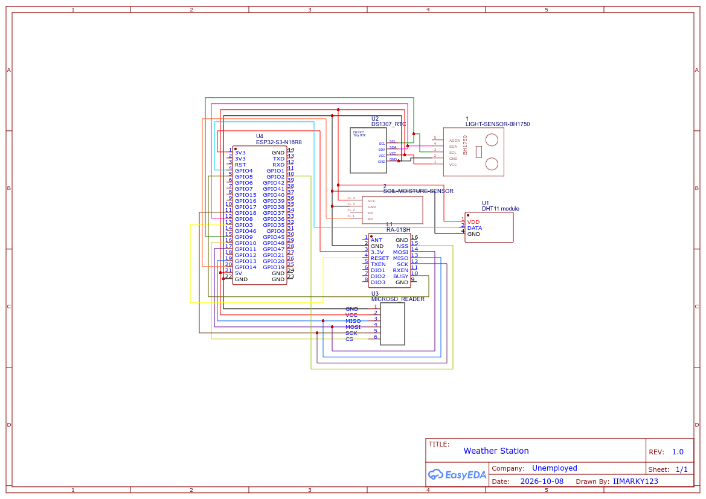

# ESP32-S3 LoRa Weather Station

Autonomous, low-cost microclimate monitoring node and LoRa relay built on the **ESP32-S3-N16R8** with an **Ai-Thinker RA-01SH (Semtech SX1262)** transceiver.

## Block Diagram


## Schematic



## Hardware Pinout Reference

| Peripheral / Net | ESP32-S3 GPIO | Pin No. | Connected Module Pin | Protocol / Signal Type |
| :--- | :--- | :---: | :--- | :--- |
| **I2C SDA** | `GPIO8` | 12 | BH1750 `SDA` (0x23), DS1307 `SDA` (0x68) | Shared I2C Data |
| **I2C SCL** | `GPIO9` | 15 | BH1750 `SCL` (0x23), DS1307 `SCL` (0x68) | Shared I2C Clock |
| **SPI SCK** | `GPIO18` | 11 | RA-01SH `SCK`, MicroSD `SCK` | Shared SPI Clock |
| **SPI MOSI** | `GPIO11` | 17 | RA-01SH `MOSI`, MicroSD `MOSI` | Shared SPI Data Out |
| **SPI MISO** | `GPIO13` | 19 | RA-01SH `MISO`, MicroSD `MISO` | Shared SPI Data In |
| **LoRa NSS** | `GPIO2` | 40 | RA-01SH `NSS` (Chip Select) | Dedicated SPI CS |
| **LoRa RESET** | `GPIO3` | 13 | RA-01SH `RESET` | Active-Low Hardware Reset |
| **LoRa BUSY** | `GPIO5` | 5 | RA-01SH `BUSY` | SX1262 Handshake / Wake-on-Radio IRQ |
| **MicroSD CS** | `GPIO10` | 16 | MicroSD Reader `CS` | Dedicated SPI CS |
| **DHT11 Data** | `GPIO4` | 4 | DHT11 `DATA` | 1-Wire Digital |
| **Soil Moisture** | `GPIO14` | 20 | Soil Moisture `A0` | Analog ADC (`ADC2_CH3`, 0–3.3V) |
| **3.3V Rail** | `3V3` | 1 | RA-01SH `3.3V` (Strictly 3.3V!) | Clean Power Rail |
| **5.0V Rail** | `5V` | 21 | Sensors (DHT11, BH1750, Soil), DS1307, SD | Main 5V Power Rail |
| **Ground** | `GND` | 22 | Common System Ground | Ground Return |
| **Status RGB LED** | `GPIO48` / `GPIO38` | Internal | Built-in WS2812 NeoPixel | System Status Indicator |

---

## Operating Modes & Built-in RGB LED Indicators

The weather station features automatic dynamic failover between cloud reporting and local web services:

| LED Color | Operating State | Description |
| :--- | :--- | :--- |
| 🟢 **Solid Green** | **Online Mode (ThingSpeak)** | Connected to Wi-Fi. Telemetry is streamed to ThingSpeak every 20s. Local web service is kept closed to save resources. |
| 🟡 **Solid Yellow** | **Local Web Dashboard (Offline)** | **Case A (Boot Wi-Fi Failure):** Broadcasts AP hotspot (`WeatherStation-ESP32` at `http://192.168.4.1/`) with local dashboard; Wi-Fi reconnect is completely disabled.<br>**Case B (ThingSpeak Failure):** If ThingSpeak fails 3 consecutive times, opens an HTTP service directly on the existing local router IP (`http://<local_ip>/`, no AP). Retries ThingSpeak every 60s; once reconnected, it automatically closes the web service and returns to Green. |
| ⚪ **Blinking Grey** | **Wi-Fi Connecting** | The ESP32 is actively attempting to establish a Wi-Fi connection. |
| 🔴 **Solid Red** | **Error State** | Critical hardware failure (sensors offline or MicroSD card failure). |

### ThingSpeak Field Mapping
* **Field 1:** Temperature (°C)
* **Field 2:** Humidity (%)
* **Field 3:** Ambient Light (Lux)
* **Field 4:** Soil Moisture (%)

---

## Quick Start Commands

### 1. Upload All Firmware Files to ESP32

```bash
mpremote connect /dev/ttyACMx cp firmware/*.py :
```

### 2. Run the Full Hardware Self-Test

```bash
mpremote connect /dev/ttyACMx run tests/test_weather_station.py
```

### 3. Run the Live Web Dashboard

```bash
mpremote connect /dev/ttyACMx run firmware/main.py
```

### 4. Access the ESP32 Local Dashboard (Offline Hotspot)

* **Default Hotspot:** Connect your phone or PC Wi-Fi to **`WeatherStation-ESP32`**.
* **URL:** Open your browser to **`http://192.168.4.1/`**.
* *(To connect to home Wi-Fi, edit `WIFI_SSID` and `WIFI_PASSWORD` in `firmware/config.py`).*

### 5. Access the Cloud Dashboard (Desktop & Android)

* **Online Web Dashboard:** [https://iimarky123.io.vn](https://iimarky123.io.vn)
* **Live Telemetry:** Streams real-time sensor data from ThingSpeak Cloud (Channel `3543024`).
* **PWA Installation:** Open the link in Chrome on Android or Desktop and tap **📱 Install App** (or browser menu `⋮` &rarr; *Add to Home screen*) to install as a standalone native-like app.
