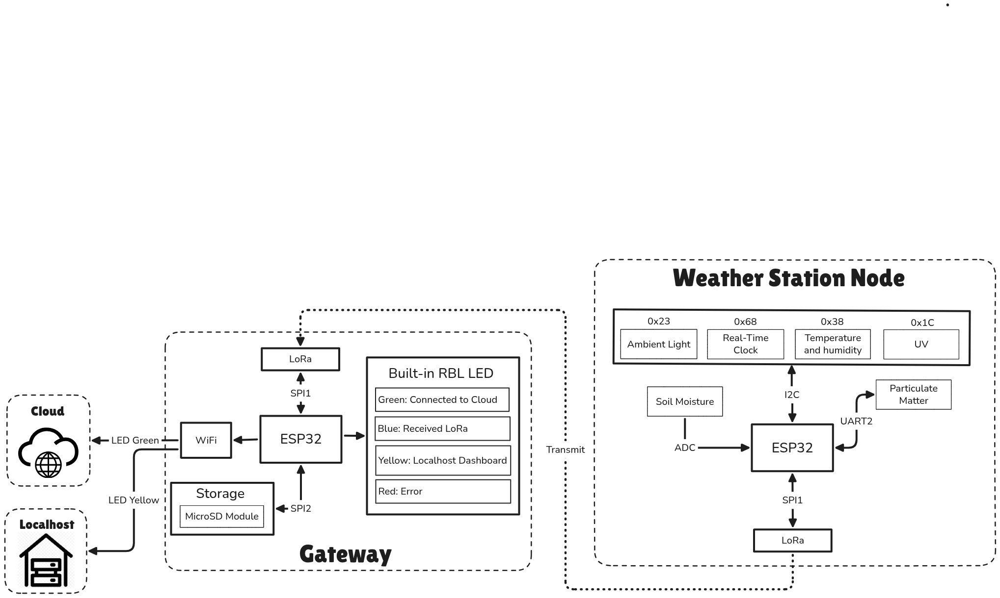

# ESP32-S3 LoRa Weather Station Network (Multi-Node & Gateway)

Autonomous, multi-sensor microclimate monitoring network built on the **ESP32-S3-N16R8** with **Ai-Thinker Ra-02 (Semtech SX1278, 434 MHz)** transceivers.

The project features three firmware targets and a cloud dashboard:

1. **Sensor Node Firmware (`firmware/node/`):** Autonomous field acquisition node reading 8 environmental sensors (temperature, humidity, ambient light, soil moisture, UV index, PM1.0, PM2.5, PM10) with ultra-low-power Deep Sleep cycling and broadcasting 26-byte binary LoRa telemetry packets.
2. **Central Gateway Firmware (`firmware/gateway/`):** Central receiver hub collecting packets from field nodes, logging records to MicroSD card (`/sd/gateway_weather_log.csv`) with automatic fallback to onboard 16MB SPI Flash (`/gateway_weather_log.csv`), routing data to ThingSpeak Cloud IoT channels, and hosting an offline local web service.
3. **Standalone Station Firmware (`firmware/standalone/`):** All-in-one field-to-cloud station reading the onboard sensors directly, synchronizing time with NTP, logging to MicroSD/Flash, streaming to ThingSpeak, and hosting a local failover dashboard (no LoRa required).
4. **Interactive Web Dashboard (`webapp/index.html`):** Progressive Web App (PWA) hosted at [https://weather.iimarky123.io.vn](https://weather.iimarky123.io.vn) featuring Leaflet.js CARTO Dark Matter mapping, dynamic real-time node coordinates, isolated node switching tabs, configurable log exports, and historical telemetry charts.

---

## Architecture & Schematics

### System Block Diagram



### Schematics

* **Sensor Node:** [Schematic Node](docs/Schematic/Schematic%20Node.png)
* **Central Gateway:** [Schematic Gateway](docs/Schematic/Schematic%20Gateway.png)

---

## LoRa Radio & Physical Layer Configuration

Both the Sensor Node and Central Gateway operate on matching Semtech SX1278 transceiver parameters:

| Parameter | Configured Value | Register Setting / Implementation |
| :--- | :--- | :--- |
| **Carrier Frequency** | `434.00 MHz` | `RegFrf (0x06..0x08)` |
| **Spreading Factor (SF)** | `SF12` | `RegModemConfig2 (0x1E) = 0xC4` |
| **Bandwidth (BW)** | `15.6 kHz` | `RegModemConfig1 (0x1D) = 0x22` (`BW_15_6 = 2`) |
| **Coding Rate (CR)** | `4/5` | `RegModemConfig1 (0x1D)` (Index `5` $\rightarrow$ bits `0b001`) |
| **Output Power** | `+20 dBm` (100 mW) | `RegPaDac (0x4D) = 0x87` (PA_BOOST High Power override) |
| **Preamble Length** | `8 symbols` | `RegPreambleMsb / Lsb (0x20..0x21)` |
| **Sync Word** | `0x12` | Private Network Isolation |
| **Low Data Rate Opt (LDRO)** | **AUTO-ENABLED (`ON`)** | `RegModemConfig3 (0x26)` bit 3 (Active when symbol time $T_s > 16.0\text{ ms}$) |

---

## 26-Byte Binary Communication Protocol

The network uses a packed C-style binary struct (`ustruct`) for telemetry transmission over LoRa.

* **Format String:** `"<BHBIhHHHHHHHH"` (Little-Endian, Total: **26 Bytes**)

### Byte Offset Mapping

| Byte Offset | Field Name | Data Type | Bytes | Value Encoding | Range / Resolution |
| :---: | :--- | :---: | :---: | :--- | :--- |
| `0` | **Node ID** | `uint8` | 1 B | Node identifier (`B`) | 1 – 255 |
| `1 – 2` | **Sequence Number** | `uint16` | 2 B | Packet sequence counter (`H`) | 0 – 65,535 |
| `3` | **Mesh Hops** | `uint8` | 1 B | Hop counter (`B`) | 0 – 255 |
| `4 – 7` | **Timestamp (Epoch)** | `uint32` | 4 B | Unix epoch seconds (`I`) | Up to Year 2106 (1s step) |
| `8 – 9` | **Temperature** | `int16` | 2 B | `temp * 100` (`h`, signed) | -327.68°C to +327.67°C (0.01°C) |
| `10 – 11` | **Humidity** | `uint16` | 2 B | `hum * 100` (`H`) | 0.00% to 100.00% (0.01%) |
| `12 – 13` | **Ambient Light** | `uint16` | 2 B | Raw Lux (`H`) | 0 to 65,535 Lux |
| `14 – 15` | **Soil Moisture** | `uint16` | 2 B | `soil_pct * 100` (`H`) | 0.00% to 100.00% (0.01%) |
| `16 – 17` | **UV Raw** | `uint16` | 2 B | Raw ADC count (`H`) | 0 to 4,095 |
| `18 – 19` | **UV Index** | `uint16` | 2 B | `uvi * 100` (`H`) | 0.00 to 655.35 (0.01 step) |
| `20 – 21` | **PM 1.0** | `uint16` | 2 B | PM1.0 integer (`H`) | 0 to 65,535 µg/m³ |
| `22 – 23` | **PM 2.5** | `uint16` | 2 B | PM2.5 integer (`H`) | 0 to 65,535 µg/m³ |
| `24 – 25` | **PM 10** | `uint16` | 2 B | PM10 integer (`H`) | 0 to 65,535 µg/m³ |

---

## Power Management & Deep Sleep Strategy

The Sensor Node implements an ultra-low-power sleep architecture:

1. **Sensor Acquisition & LoRa TX:** The ESP32-S3 boots, reads all I2C/UART/ADC sensors, encodes the 26-byte packet, and broadcasts over LoRa.
2. **Sequence Persistence:** Because standard RAM is cleared during deep sleep, the monotonic sequence number is preserved in **ESP32 RTC memory** (`machine.RTC().memory()`) across sleep resets.
3. **Radio Sleep:** The transceiver's analog circuitry is explicitly shut down via `lora.sleep()` (`MODE_SLEEP`), dropping radio current to **~0.2 µA**.
4. **LED Power-Down:** The onboard WS2812 status LED is turned off (`led.turn_off()`) prior to sleep.
5. **Deep Sleep Execution:** The node enters deep sleep via `machine.deepsleep(config.TX_INTERVAL_SEC * 1000)` and restarts execution upon timer expiration (`machine.DEEPSLEEP_RESET`).

---

## Hardware Pinout Reference

### 1. Sensor Node Pinout (ESP32-S3-N16R8)

| Peripheral / Signal | ESP32-S3 Pin | Pin No. | Connected Device / Pin | Description / Protocol |
| :--- | :--- | :---: | :--- | :--- |
| **I2C SDA** | `GPIO8` | 12 | DS1307, BH1750, LTR390, AM2301B | Shared I2C Data (100 kHz) |
| **I2C SCL** | `GPIO9` | 15 | DS1307, BH1750, LTR390, AM2301B | Shared I2C Clock (100 kHz) |
| **UART TX (APM10)** | `GPIO10` | 16 | APM10 RX (via LLC) | UART1 Transmit (1200 baud) |
| **UART RX (APM10)** | `GPIO14` | 20 | APM10 TX (via LLC) | UART1 Receive (1200 baud) |
| **LoRa SCK** | `GPIO18` | 11 | Ra-02 (SX1278) `SCK` | SPI Clock |
| **LoRa MOSI** | `GPIO11` | 17 | Ra-02 (SX1278) `MOSI` | SPI MOSI |
| **LoRa MISO** | `GPIO13` | 19 | Ra-02 (SX1278) `MISO` | SPI MISO |
| **LoRa NSS / CS** | `GPIO2` | 39 | Ra-02 (SX1278) `NSS` | LoRa SPI Chip Select |
| **LoRa RESET** | `GPIO3` | 13 | Ra-02 (SX1278) `RESET` | Active-Low Hardware Reset |
| **Soil Moisture ADC** | `GPIO6` | 6 | Soil Moisture Sensor AO | Analog ADC (`ADC1_CH5`, 0–3.3V) |
| **Status RGB LED** | `GPIO48` / `GPIO38` | Internal | Onboard WS2812 NeoPixel | Blue flash on TX, Green online |
| **3.3V Rail** | `3V3` | 1 | Sensors, RTC, LLC LV, Ra-02 | Main 3.3V Supply |
| **5.0V Rail** | `5V` | 21 | APM10 VCC, LLC HV | Main 5.0V Supply (from USB/Regulator) |
| **Ground** | `GND` | 22 | Common System Ground | Ground Return |

### 2. Central Gateway Pinout (ESP32-S3-N16R8)

| Peripheral / Signal | ESP32-S3 Pin | Pin No. | Connected Device / Pin | Description / Protocol |
| :--- | :--- | :---: | :--- | :--- |
| **LoRa SCK** | `GPIO18` | 11 | Ra-02 (SX1278) `SCK` | Dedicated SPI1 Bus Clock |
| **LoRa MOSI** | `GPIO11` | 17 | Ra-02 (SX1278) `MOSI` | Dedicated SPI1 Bus MOSI |
| **LoRa MISO** | `GPIO13` | 19 | Ra-02 (SX1278) `MISO` | Dedicated SPI1 Bus MISO |
| **LoRa NSS / CS** | `GPIO2` | 39 | Ra-02 (SX1278) `NSS` | LoRa Dedicated SPI1 CS |
| **LoRa RESET** | `GPIO3` | 13 | Ra-02 (SX1278) `RESET` | Active-Low Hardware Reset |
| **LoRa DIO0** | `GPIO6` | 6 | Ra-02 (SX1278) `DIO1/DIO0` | LoRa RX/TX Interrupt |
| **MicroSD SCK** | `GPIO36` | 27 | MicroSD Module `SCK` | Dedicated SPI2 Bus Clock |
| **MicroSD MOSI** | `GPIO35` | 26 | MicroSD Module `MOSI` | Dedicated SPI2 Bus MOSI |
| **MicroSD MISO** | `GPIO37` | 28 | MicroSD Module `MISO` | Dedicated SPI2 Bus MISO |
| **MicroSD CS** | `GPIO4` | 8 | MicroSD Module `CS` | MicroSD Dedicated SPI2 CS |
| **Status RGB LED** | `GPIO48` / `GPIO38` | Internal | Onboard WS2812 NeoPixel | Visual System State |

---

## Storage Resiliency (Dual MicroSD & Onboard Flash Fallback)

The Central Gateway implements fault-tolerant persistent storage:

1. **Primary Medium (MicroSD Card):** Mounts at `/sd` via `GPIO4` Chip Select on dedicated SPI bus 2 (`GPIO36` SCK, `GPIO35` MOSI, `GPIO37` MISO) and logs to `/sd/gateway_weather_log.csv`.
2. **Automatic Fallback (Internal SPI Flash):** If the MicroSD card fails to mount on boot or errors during runtime write operations, the gateway automatically switches to the onboard 16MB SPI flash memory (`/gateway_weather_log.csv`).
3. **RAM Ring Buffer:** Retains the 50 most recent records in memory for immediate web dashboard rendering and instant historical review.
4. **Local Web Server Integration:**
   * Dynamic status indicator in the UI:
     * `● MicroSD (/sd)` (Green) when MicroSD is active.
     * `● Internal Flash (16MB)` (Cyan) when running on internal flash fallback.
     * `✕ RAM Buffer Only` (Red) when persistent storage is unavailable.
   * `GET /download` serves the CSV log from whichever storage medium is currently active without downtime.

---

## Operating Modes & Status RGB LED

| LED Color | Operating State | Description |
| :--- | :--- | :--- |
| 🟢 **Solid Green** | **Online Mode (ThingSpeak)** | Connected to router Wi-Fi. Telemetry pushed to ThingSpeak Cloud every 20s. Local web server remains off to conserve resources. |
| 🟡 **Solid Yellow** | **Local Web Dashboard (Offline)** | **Case A (Boot Wi-Fi Failure):** If router Wi-Fi fails on initial boot, it creates an AP hotspot (`WeatherStation-ESP32` at `192.168.4.1`) and never retries Wi-Fi.<br>**Case B (ThingSpeak Outage):** If ThingSpeak fails 3 consecutive times, launches the dashboard server on the local router IP (`http://<local_ip>/`, no AP). Automatically recovers to Green upon successful cloud transmission. |
| ⚪ **Blinking Grey** | **Wi-Fi Connecting** | The Gateway is actively searching and negotiating a connection with the configured Wi-Fi AP. |
| 🔵 **Blue Flash** | **LoRa RX / TX Event** | Flashes Blue (80–100ms) whenever a LoRa packet is transmitted by Node or received by Gateway. |
| 🔴 **Solid Red** | **Hardware Error** | Transceiver initialization failure or critical peripheral failure. |

---

## Cloud & Multi-Node Mapping

### Configured Telemetry Channels

* **📍 Node 1:**
  * **ThingSpeak Channel:** `3543024` (Write: `XXXXXXXXXXX` / Read: `WK8Z6FH8W8UTJS7Q`)
* **📍 Node 2:**
  * **ThingSpeak Channel:** `3558474` (Write: `XXXXXXXXXXX` / Read: `6Y885RXM1MREEGV1`)

### Dynamic Map & Telemetry Exports

* **Dynamic Coordinates:** The web application dynamically fetches each node's geographic coordinates via API metadata instead of hardcoded coordinates.
* **Configurable Log Downloads:** Telemetry logs can be downloaded in selectable quantities (30, 50, 100, 250, 500, 1000, 8000, Custom) with support for both CSV and JSON formats.

### ThingSpeak Field Mapping (Both Channels)

* **Field 1:** Temperature (°C) — *AM2301B*
* **Field 2:** Relative Humidity (%) — *AM2301B*
* **Field 3:** Ambient Light (Lux) — *BH1750*
* **Field 4:** Ultraviolet Index (UVI) — *LTR390*
* **Field 5:** Particulate Matter PM2.5 (µg/m³) — *APM10*
* **Field 6:** Particulate Matter PM10 (µg/m³) — *APM10*
* **Field 7:** Particulate Matter PM1.0 (µg/m³) — *APM10*
* **Field 8:** Soil Moisture (%) — *Analog ADC*

---

## Quick Start & Deployment

### 1. Flashing the Sensor Node (`/dev/ttyACM0`)

```bash
# Upload shared modules, drivers, and node firmware
mpremote connect /dev/ttyACM0 cp firmware/common/protocol.py :protocol.py
mpremote connect /dev/ttyACM0 cp firmware/common/sx1278.py :sx1278.py
mpremote connect /dev/ttyACM0 cp firmware/common/status_led.py :status_led.py
mpremote connect /dev/ttyACM0 cp firmware/node/config.py :config.py
mpremote connect /dev/ttyACM0 cp firmware/node/main.py :main.py
mpremote connect /dev/ttyACM0 cp -r firmware/node/drivers/ :drivers/

# Run the node
mpremote connect /dev/ttyACM0 run firmware/node/main.py
```

### 2. Flashing the Central Gateway (`/dev/ttyACM1`)

```bash
# Upload shared modules and gateway firmware
mpremote connect /dev/ttyACM1 cp firmware/common/protocol.py :protocol.py
mpremote connect /dev/ttyACM1 cp firmware/common/sx1278.py :sx1278.py
mpremote connect /dev/ttyACM1 cp firmware/common/status_led.py :status_led.py
mpremote connect /dev/ttyACM1 cp firmware/gateway/config.py :config.py
mpremote connect /dev/ttyACM1 cp firmware/gateway/sdcard.py :sdcard.py
mpremote connect /dev/ttyACM1 cp firmware/gateway/storage.py :storage.py
mpremote connect /dev/ttyACM1 cp firmware/gateway/thingspeak.py :thingspeak.py
mpremote connect /dev/ttyACM1 cp firmware/gateway/web_server.py :web_server.py
mpremote connect /dev/ttyACM1 cp firmware/gateway/main.py :main.py

# Run the gateway
mpremote connect /dev/ttyACM1 run firmware/gateway/main.py
```

### 3. Flashing the Standalone Station

```bash
# Upload standalone files and sensor drivers
mpremote connect /dev/ttyACM0 cp firmware/common/status_led.py :status_led.py
mpremote connect /dev/ttyACM0 cp firmware/standalone/config.py :config.py
mpremote connect /dev/ttyACM0 cp firmware/standalone/sdcard.py :sdcard.py
mpremote connect /dev/ttyACM0 cp firmware/standalone/storage.py :storage.py
mpremote connect /dev/ttyACM0 cp firmware/standalone/thingspeak.py :thingspeak.py
mpremote connect /dev/ttyACM0 cp firmware/standalone/web_server.py :web_server.py
mpremote connect /dev/ttyACM0 cp firmware/standalone/main.py :main.py
mpremote connect /dev/ttyACM0 cp -r firmware/standalone/drivers/ :drivers/

# Run the standalone station
mpremote connect /dev/ttyACM0 run firmware/standalone/main.py
```

### 4. Accessing the Dashboards

* **Public Cloud Dashboard:** [https://weather.iimarky123.io.vn](https://weather.iimarky123.io.vn)
* **Local Offline Hotspot:** Connect to Wi-Fi SSID **`WeatherStation-ESP32`** and navigate to **`http://192.168.4.1/`**
* **Local Network Fallback:** If ThingSpeak is unreachable, open **`http://<gateway_local_ip>/`** from your local router network.
