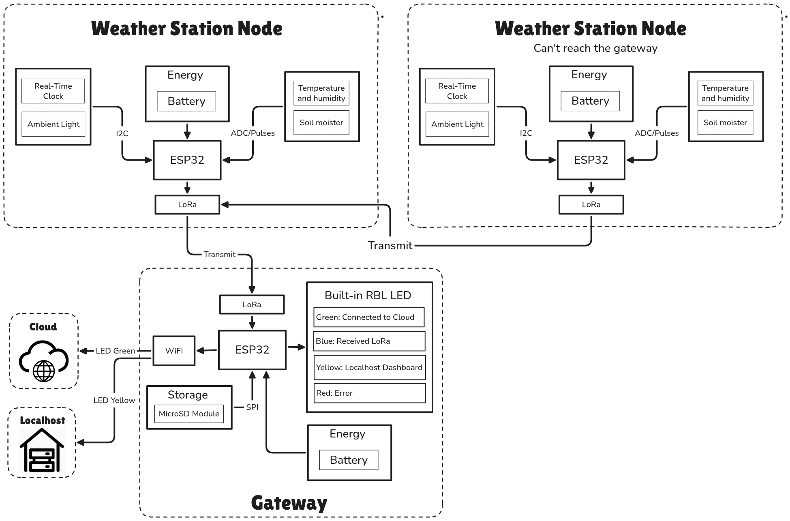

# ESP32-S3 LoRa Weather Station Network (Multi-Node & Gateway)

Autonomous, multi-sensor microclimate monitoring network built on the **ESP32-S3-N16R8** with **Ai-Thinker Ra-02 (Semtech SX1278, 434 MHz)** transceivers.

The project features three firmware targets and a cloud dashboard:

1. **Sensor Node Firmware (`firmware/node/`):** Autonomous field acquisition node reading 7 environmental sensors (temperature, humidity, ambient light, soil moisture, UV index, PM2.5, PM10) and broadcasting periodic LoRa telemetry packets.
2. **Central Gateway Firmware (`firmware/gateway/`):** Central receiver hub collecting packets from all nodes, logging records to MicroSD card (`/sd/gateway_weather_log.csv`) with automatic fallback to onboard 16MB SPI Flash (`/gateway_weather_log.csv`), routing data to ThingSpeak Cloud IoT channels, and hosting an offline local web service.
3. **Standalone Station Firmware (`firmware/standalone/`):** All-in-one field-to-cloud station reading the 7 onboard sensors directly, synchronizing time with NTP, logging to MicroSD/Flash, streaming to ThingSpeak Channel 1, and hosting a local failover dashboard (no LoRa required).
4. **Interactive Web Dashboard (`webapp/index.html`):** Progressive Web App (PWA) hosted at [https://iimarky123.io.vn](https://iimarky123.io.vn) featuring Leaflet.js CARTO Dark Matter mapping, real-time node coordinates, isolated node switching tabs, and historical sensor telemetry charts.

---

## Architecture & Schematics

### System Block Diagram



### Schematics

* **Sensor Node:** [Schematic Node](docs/Schematic/Schematic%20Node.png)
* **Central Gateway:** [Schematic Gateway](docs/Schematic/Schematic%20Gateway.png)

---

## Hardware Pinout Reference

### 1. Sensor Node Pinout (ESP32-S3-N16R8)

| Peripheral / Signal | ESP32-S3 Pin | Pin No. | Connected Device / Pin | Description / Protocol |
| :--- | :--- | :---: | :--- | :--- |
| **I2C SDA** | `GPIO8` | 12 | DS1307, BH1750, LTR390, AM2301B, APM10 (via LLC) | Shared I2C Data (100 kHz) |
| **I2C SCL** | `GPIO9` | 15 | DS1307, BH1750, LTR390, AM2301B, APM10 (via LLC) | Shared I2C Clock (100 kHz) |
| **Soil Moisture ADC** | `GPIO14` | 20 | Soil Moisture Sensor `A0` | Analog ADC (`ADC2_CH3`, 0–3.3V) |
| **LoRa SCK** | `GPIO18` | 11 | Ra-02 (SX1278) `SCK` | SPI Clock |
| **LoRa MOSI** | `GPIO11` | 17 | Ra-02 (SX1278) `MOSI` | SPI MOSI |
| **LoRa MISO** | `GPIO13` | 19 | Ra-02 (SX1278) `MISO` | SPI MISO |
| **LoRa NSS / CS** | `GPIO2` | 39 | Ra-02 (SX1278) `NSS` | LoRa SPI Chip Select |
| **LoRa RESET** | `GPIO3` | 13 | Ra-02 (SX1278) `RESET` | Active-Low Hardware Reset |
| **LoRa DIO0** | `GPIO6` | 6 | Ra-02 (SX1278) `DIO1/DIO0` | Packet RX/TX Done Interrupt |
| **LoRa BUSY** | `GPIO5` | 5 | Ra-02 (SX1278) `BUSY` | Status / Busy Line |
| **Status RGB LED** | `GPIO48` / `GPIO38` | Internal | Onboard WS2812 NeoPixel | Blue flash on TX, Green online |
| **3.3V Rail** | `3V3` | 1 | Sensors, RTC, LLC LV, Ra-02 | Main 3.3V Supply |
| **5.0V Rail** | `5V` | 21 | APM10 VCC, LLC HV | Main 5.0V Supply (from USB/Regulator) |
| **Ground** | `GND` | 22 | Common System Ground | Ground Return |

### 2. Central Gateway Pinout (ESP32-S3-N16R8)

| Peripheral / Signal | ESP32-S3 Pin | Pin No. | Connected Device / Pin | Description / Protocol |
| :--- | :--- | :---: | :--- | :--- |
| **SPI SCK** | `GPIO18` | 11 | Ra-02 `SCK`, MicroSD `SCK` | Shared SPI Bus Clock |
| **SPI MOSI** | `GPIO11` | 17 | Ra-02 `MOSI`, MicroSD `MOSI` | Shared SPI Bus MOSI |
| **SPI MISO** | `GPIO13` | 19 | Ra-02 `MISO`, MicroSD `MISO` | Shared SPI Bus MISO |
| **LoRa NSS / CS** | `GPIO2` | 39 | Ra-02 `NSS` | LoRa Dedicated SPI CS |
| **LoRa RESET** | `GPIO3` | 13 | Ra-02 `RESET` | LoRa Reset Pin |
| **LoRa DIO0** | `GPIO6` | 6 | Ra-02 `DIO1/DIO0` | LoRa RX/TX Interrupt |
| **MicroSD CS** | `GPIO10` | 16 | MicroSD Reader `CS` | MicroSD Dedicated SPI CS |
| **Status RGB LED** | `GPIO48` / `GPIO38` | Internal | Onboard WS2812 NeoPixel | Visual System State |

---

## Storage Resiliency (Dual MicroSD & Onboard Flash Fallback)

The Central Gateway implements fault-tolerant persistent storage:

1. **Primary Medium (MicroSD Card):** Mounts at `/sd` via `GPIO10` Chip Select on SPI bus 1 and logs to `/sd/gateway_weather_log.csv`.
2. **Automatic Fallback (Internal SPI Flash):** If the MicroSD card fails to mount on boot or errors during runtime write operations, the gateway automatically switches to the onboard 16MB SPI flash memory (`/gateway_weather_log.csv`).
3. **RAM Ring Buffer:** Retains the 50 most recent records in memory for immediate web dashboard rendering and instant historical review.
4. **Local Web Server Integration:**
   * Dynamic status indicator in the UI:
     * `● MicroSD (/sd)` (Green) when MicroSD is active.
     * `● Internal Flash (16MB)` (Cyan) when running on internal flash fallback.
     * `✕ RAM Buffer Only` (Red) when persistent storage is unavailable.
   * `GET /download` serves the CSV log from whichever storage medium is currently active without downtime.

---

## Operating Modes & Status RGB LED

| LED Color | Operating State | Description |
| :--- | :--- | :--- |
| 🟢 **Solid Green** | **Online Mode (ThingSpeak)** | Connected to router Wi-Fi. Telemetry pushed to ThingSpeak Cloud every 20s. Local web server remains off to conserve resources. |
| 🟡 **Solid Yellow** | **Local Web Dashboard (Offline)** | **Case A (Boot Wi-Fi Failure):** If router Wi-Fi fails on initial boot, it creates an AP hotspot (`WeatherStation-ESP32` at `192.168.4.1`) and never retries Wi-Fi.<br>**Case B (ThingSpeak Outage):** If ThingSpeak fails 3 consecutive times, launches the dashboard server on the local router IP (`http://<local_ip>/`, no AP). Automatically recovers to Green upon successful cloud transmission. |
| ⚪ **Blinking Grey** | **Wi-Fi Connecting** | The Gateway is actively searching and negotiating a connection with the configured Wi-Fi AP. |
| 🔵 **Blue Flash** | **LoRa RX / TX Event** | Flashes Blue (80–100ms) whenever a LoRa packet is transmitted by Node or received by Gateway. |
| 🔴 **Solid Red** | **Hardware Error** | Transceiver initialization failure or critical peripheral failure. |

---

## Cloud & Multi-Node Mapping

### Configured Telemetry Channels & Locations

* **📍 Node 1 (Station North):**
  * **ThingSpeak Channel:** `3543024` (Write: `XXXXXXXXXXX` / Read: `WK8Z6FH8W8UTJS7Q`)
  * **Coordinates:** `10.841168, 106.809889`
* **📍 Node 2 (Station South):**
  * **ThingSpeak Channel:** `3558474` (Write: `XXXXXXXXXXX` / Read: `6Y885RXM1MREEGV1`)
  * **Coordinates:** `10.840083, 106.811400`

### ThingSpeak Field Mapping (Both Channels)

* **Field 1:** Temperature (°C) — *AM2301B*
* **Field 2:** Relative Humidity (%) — *AM2301B*
* **Field 3:** Ambient Light (Lux) — *BH1750*
* **Field 4:** Soil Moisture (%) — *Analog ADC* *(Note: raw mV is logged only to console, never sent to cloud or SD)*
* **Field 5:** Ultraviolet Index (UVI) — *LTR390*
* **Field 6:** Particulate Matter PM2.5 (µg/m³) — *APM10*
* **Field 7:** Particulate Matter PM10 (µg/m³) — *APM10*

---

## Quick Start & Deployment

### 1. Flashing the Sensor Node

Connect the Node ESP32-S3 board to your workstation:

```bash
# Upload shared modules and drivers
mpremote connect /dev/ttyACM0 cp firmware/common/sx1278.py :sx1278.py
mpremote connect /dev/ttyACM0 cp firmware/common/status_led.py :status_led.py
mpremote connect /dev/ttyACM0 cp firmware/common/protocol.py :protocol.py
mpremote connect /dev/ttyACM0 cp firmware/node/config.py :config.py
mpremote connect /dev/ttyACM0 cp firmware/node/main.py :main.py
mpremote connect /dev/ttyACM0 cp -r firmware/node/drivers/ :drivers/

# Run the node
mpremote connect /dev/ttyACM0 run firmware/node/main.py
```

### 2. Flashing the Central Gateway

Connect the Gateway ESP32-S3 board to your workstation:

```bash
# Upload shared modules and gateway files
mpremote connect /dev/ttyACM0 cp firmware/common/sx1278.py :sx1278.py
mpremote connect /dev/ttyACM0 cp firmware/common/status_led.py :status_led.py
mpremote connect /dev/ttyACM0 cp firmware/common/protocol.py :protocol.py
mpremote connect /dev/ttyACM0 cp firmware/gateway/config.py :config.py
mpremote connect /dev/ttyACM0 cp firmware/gateway/sdcard.py :sdcard.py
mpremote connect /dev/ttyACM0 cp firmware/gateway/storage.py :storage.py
mpremote connect /dev/ttyACM0 cp firmware/gateway/thingspeak.py :thingspeak.py
mpremote connect /dev/ttyACM0 cp firmware/gateway/web_server.py :web_server.py
mpremote connect /dev/ttyACM0 cp firmware/gateway/main.py :main.py

# Run the gateway
mpremote connect /dev/ttyACM0 run firmware/gateway/main.py
```

### 3. Flashing the Standalone Station (All-in-One Node & Local Server)

Connect the ESP32-S3 board with sensors and MicroSD:

```bash
# Upload standalone files and sensor drivers
mpremote connect /dev/ttyACM0 cp firmware/common/status_led.py :status_led.py
mpremote connect /dev/ttyACM0 cp firmware/standalone/config.py :config.py
mpremote connect /dev/ttyACM0 cp firmware/standalone/sdcard.py :sdcard.py
mpremote connect /dev/ttyACM0 cp firmware/standalone/storage.py :storage.py
mpremote connect /dev/ttyACM0 cp firmware/standalone/thingspeak.py :thingspeak.py
mpremote connect /dev/ttyACM0 cp firmware/standalone/web_server.py :web_server.py
mpremote connect /dev/ttyACM0 cp firmware/standalone/main.py :main.py
mpremote connect /dev/ttyACM0 cp -r firmware/standalone/drivers/ :drivers/

# Run the standalone station
mpremote connect /dev/ttyACM0 run firmware/standalone/main.py
```

### 4. Accessing the Dashboards

* **Public Cloud Dashboard:** [https://weather.iimarky123.io.vn](https://weather.iimarky123.io.vn)
* **Local Offline Hotspot:** Connect to Wi-Fi SSID **`WeatherStation-ESP32`** and navigate to **`http://192.168.4.1/`**
* **Local Network Fallback:** If ThingSpeak is unreachable, open **`http://<gateway_local_ip>/`** from your home router network.
