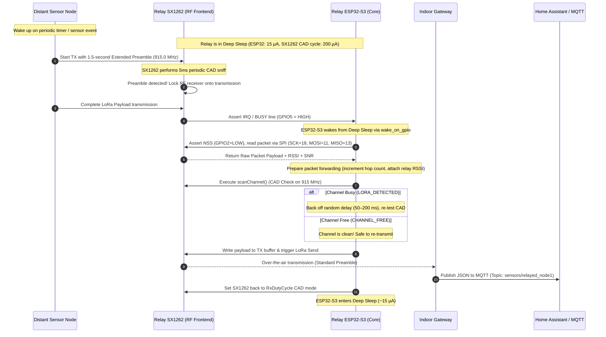

# LoRa Weather Station & Asynchronous Wake-on-Radio (WoR) Relay Node
**Project:** ESP32-S3 LoRa Low-Cost Weather Station & Range Extender  
**Revision Date:** 2026-10-14  
**Architecture:** Dual-Function Weather Node + Asynchronous LoRa Relay (No Clock Sync)  
**Hardware Reference:** [Schematic_Wiring_2026-10-14.md](file:///home/iimarky123/Storage/IOT_projects/LORA/docs/Schematic_Wiring_2026-10-14.md)  
**Interactive Visual Diagram:** [Weather_Station_Block_Diagram.excalidraw.md](file:///home/iimarky123/Storage/IOT_projects/LORA/Excalidraw/Weather_Station_Block_Diagram.excalidraw.md)

---

## 1. System Overview & New Architecture

This architecture updates the standalone weather station into a **Dual-Role Smart IoT Node**:
1. **Autonomous Local Weather Station:** Periodically logs ambient temperature, relative humidity, light intensity, and soil moisture to an on-board MicroSD card and transmits local telemetry.
2. **Asynchronous LoRa Range Extender / Relay Node:** Acts as a transparent, battery-friendly intermediate relay for distant remote sensor nodes (e.g., deep garden probes, greenhouse monitors, perimeter sensors) that cannot reach the central indoor gateway directly.

### How Asynchronous Wake-on-Radio (WoR) Works (No Clock Sync):
* **No Real-Time Clock Synchronization Required:** Distant nodes can wake up and transmit at arbitrary or randomized intervals without needing matching clocks or time synchronization beacons.
* **Extended Wake-up Preamble:** When a distant node transmits, it sends an extended LoRa preamble ($\approx 1.0\text{–}1.5\text{ seconds}$) instead of the standard 8 symbols ($\approx 10\text{ ms}$).
* **Hardware `RxDutyCycle` CAD Sniffing:** The relay node's **ESP32-S3 remains in Deep Sleep ($\sim 15\ \mu\text{A}$)**. The **SX1262 radio** autonomously cycles:
  - Sleeps for $\sim 500\text{ ms}$ ($\sim 1.5\ \mu\text{A}$).
  - Wakes up for $\sim 3\text{–}5\text{ ms}$ to perform **Channel Activity Detection (CAD)** on 915.0 MHz.
  - If no preamble is detected, it returns to sleep immediately (average radio current $\approx 150\text{–}250\ \mu\text{A}$).
  - When the distant node's extended preamble is detected, the SX1262 locks onto the packet and pulses its **IRQ line (GPIO5)**, waking the ESP32-S3 from Deep Sleep.
* **Listen Before Talk (LBT / CSMA-CA):** Before re-transmitting the forwarded packet (or transmitting its own weather data), the relay node performs a fast $\approx 2\text{ ms}$ CAD scan (`scanChannel()`). If the channel is clear, it transmits; if busy, it performs random backoff to avoid on-air packet collisions.

---

## 2. Weather Station & Relay Node — Internal Hardware Architecture

```mermaid
flowchart TD
    %% Styling
    classDef mcuStyle fill:#1e293b,stroke:#38bdf8,stroke-width:2px,color:#f8fafc;
    classDef powerStyle fill:#78350f,stroke:#fbbf24,stroke-width:2px,color:#fef3c7;
    classDef sensorStyle fill:#064e3b,stroke:#34d399,stroke-width:2px,color:#ecfdf5;
    classDef storageStyle fill:#312e81,stroke:#818cf8,stroke-width:2px,color:#e0e7ff;
    classDef rfStyle fill:#701a75,stroke:#f472b6,stroke-width:2px,color:#fdf2f8;
    classDef wakeStyle fill:#831843,stroke:#f43f5e,stroke-width:2px,stroke-dasharray: 4 4,color:#fff1f2;

    %% Power Distribution
    subgraph SUB_POWER ["1. Power Distribution Subsystem"]
        PWR_IN["5V DC Power Source\n(Solar Panel + LiFePO4 / USB-C)"]:::powerStyle
        RAIL_5V["Main 5.0V Bus\n(ESP32-S3 Pin 21)"]:::powerStyle
        LDO_3V3["Onboard AMS1117-3.3 LDO\n(5.0V → 3.3V Low-Dropout)"]:::powerStyle
        RAIL_3V3["Dedicated 3.3V Rail\n(ESP32-S3 Pin 1 — LoRa Only)"]:::powerStyle
        GND_BUS["System Ground Bus (GND)\n(ESP32-S3 Pin 22)"]:::powerStyle
        
        PWR_IN --> RAIL_5V
        RAIL_5V --> LDO_3V3
        LDO_3V3 --> RAIL_3V3
    end

    %% Main Processing Core
    subgraph SUB_MCU ["2. Processing Core — ESP32-S3-N16R8 (Relay & Sensor Controller)"]
        MCU_CORE["Dual-Core Xtensa LX7 @ 240 MHz\n(MicroPython v1.29.0)"]:::mcuStyle
        MCU_MEM["Memory: 16MB Flash | 8MB Octal PSRAM"]:::mcuStyle
        
        subgraph MCU_WAKE ["Sleep & Wakeup State Machine"]
            WAKE_RTC["Timer Wakeup:\nPeriodic Weather Logging\n(Every 10–15 Minutes)"]:::wakeStyle
            WAKE_GPIO["Ext GPIO Wakeup (GPIO5):\nTriggered by SX1262 CAD\n(On Distant Node Transmission)"]:::wakeStyle
            DEEP_SLEEP["Deep Sleep State\n(~15 µA Current Draw)"]:::mcuStyle
        end

        subgraph MCU_PERIPH ["Hardware Controllers & Peripherals"]
            P_SPI["FSPI Controller\n• SCK: GPIO18\n• MOSI: GPIO11\n• MISO: GPIO13"]:::mcuStyle
            P_I2C["I2C0 Controller\n• SDA: GPIO8\n• SCL: GPIO9"]:::mcuStyle
            P_ADC["SAR ADC2 CH3\n• Input: GPIO14 (Soil AO)"]:::mcuStyle
            P_CTRL["Control GPIOs\n• DHT11: GPIO4\n• LoRa NSS: GPIO2\n• LoRa RST: GPIO3\n• LoRa BUSY/IRQ: GPIO5\n• SD CS: GPIO10"]:::mcuStyle
        end

        MCU_CORE --- MCU_MEM
        MCU_CORE --- MCU_WAKE
        MCU_CORE --- MCU_PERIPH
    end

    %% Environmental Sensors
    subgraph SUB_SENSORS ["3. Environmental Sensor Suite"]
        S_DHT["DHT11 Sensor\n(Air Temp & Humidity)\nPin: GPIO4 (1-Wire)"]:::sensorStyle
        S_BH["BH1750 (GY-30)\n(Ambient Lux Sensor)\nAddr: 0x23 | Pins: SDA(8), SCL(9)"]:::sensorStyle
        S_SOIL["Soil Moisture Sensor\n(Resistive / Capacitive)\nPin: GPIO14 (ADC2_CH3)"]:::sensorStyle
    end

    %% Storage & RTC
    subgraph SUB_STORAGE ["4. Timekeeping & Local Backup"]
        U_RTC["DS1307 RTC\n(CR2032 Backup Battery)\nAddr: 0x68 | Pins: SDA(8), SCL(9)"]:::storageStyle
        U_SD["MicroSD Card Module\n(FAT32 Local Log Buffer)\nPins: CS(10), SCK(18), MOSI(11), MISO(13)"]:::storageStyle
    end

    %% LoRa Transceiver (WoR + LBT)
    subgraph SUB_LORA ["5. LoRa RF Transceiver Subsystem (Wake-on-Radio + LBT)"]
        MOD_LORA["Ai-Thinker RA-01SH (SX1262)\n• Frequency: 915.0 MHz\n• Autonomous RxDutyCycle CAD Mode\n• Listen Before Talk (LBT) Engine\n• Power: Clean 3.3V Rail (Strict)\n• SPI: SCK(18), MOSI(11), MISO(13)\n• Controls: NSS(2), RST(3), BUSY(5)"]:::rfStyle
        RF_SW["Internal DIO2 RF Switch"]:::rfStyle
        ANT_LORA["915 MHz Antenna\n(IPEX to SMA Whip)"]:::rfStyle

        MOD_LORA --- RF_SW <--> ANT_LORA
    end

    %% Power Wiring
    RAIL_5V ==>|5V VCC| S_DHT
    RAIL_5V ==>|5V VCC| S_BH
    RAIL_5V ==>|5V VCC| S_SOIL
    RAIL_5V ==>|5V VCC (>=4.5V)| U_RTC
    RAIL_5V ==>|5V VCC| U_SD
    RAIL_3V3 ==>|Strict 3.3V| MOD_LORA
    GND_BUS -.->|Ground Bus| SUB_MCU
    GND_BUS -.->|Ground Bus| SUB_SENSORS
    GND_BUS -.->|Ground Bus| SUB_STORAGE
    GND_BUS -.->|Ground Bus| SUB_LORA

    %% Bus Interconnections
    P_I2C ===|Shared I2C Bus (GPIO8, GPIO9)| S_BH
    P_I2C ===|Shared I2C Bus (GPIO8, GPIO9)| U_RTC
    P_SPI ===|Shared SPI Bus (GPIO18, 11, 13)| MOD_LORA
    P_SPI ===|Shared SPI Bus (GPIO18, 11, 13)| U_SD

    %% Control & Wakeup Lines
    P_CTRL -->|CS: GPIO10| U_SD
    P_CTRL -->|NSS: GPIO2| MOD_LORA
    P_CTRL -->|RST: GPIO3| MOD_LORA
    P_CTRL <-->|1-Wire: GPIO4| S_DHT
    S_SOIL -->|Analog 0–3.3V| P_ADC
    MOD_LORA ==>|Wake-on-Radio IRQ (GPIO5)| WAKE_GPIO
```

---

## 3. End-to-End Multi-Hop IoT Network Architecture

This network diagram shows how distant, non-line-of-sight sensor nodes route through the Weather Station Relay to reach the indoor gateway without keeping any battery-powered node constantly awake.

```mermaid
flowchart LR
    %% Styles
    classDef leafStyle fill:#064e3b,stroke:#34d399,stroke-width:2px,color:#ecfdf5;
    classDef relayStyle fill:#1e293b,stroke:#38bdf8,stroke-width:2px,color:#f8fafc;
    classDef rfLink fill:#701a75,stroke:#f472b6,stroke-width:2px,stroke-dasharray: 4 4,color:#fdf2f8;
    classDef gwStyle fill:#1e1b4b,stroke:#818cf8,stroke-width:2px,color:#e0e7ff;
    classDef netStyle fill:#14532d,stroke:#22c55e,stroke-width:2px,color:#f0fdf4;
    classDef srvStyle fill:#78350f,stroke:#fbbf24,stroke-width:2px,color:#fef3c7;
    classDef appStyle fill:#4c1d95,stroke:#c084fc,stroke-width:2px,color:#faf5ff;

    %% Distant Sensor Nodes
    subgraph LEAF_NODES ["Distant Remote Sensor Nodes (Out of Gateway Range)"]
        direction TB
        NODE_SOIL["Remote Soil Probe Node\n• Battery Powered (18650)\n• Long Preamble (1.5s TX)\n• Telemetry: Moisture & Temp"]:::leafStyle
        NODE_RAIN["Remote Rain / Well Node\n• Battery Powered\n• Long Preamble (1.5s TX)\n• Telemetry: Water Level / Pulse"]:::leafStyle
    end

    %% Hop 1: LoRa RF Link with Wake-on-Radio
    subgraph HOP1 ["LoRa Hop 1: Wake-on-Radio Link"]
        direction TB
        WOR_LINK["915.0 MHz LoRa Link\n• Extended Wakeup Preamble (~1.5s)\n• Payload: Node ID + Sensor Data\n• Asynchronous (No Time Sync)\n• Range: 1–3+ km across obstacles"]:::rfLink
    end

    %% Intermediate Relay & Weather Station
    subgraph RELAY_STATION ["Weather Station & LoRa Range Extender (Intermediate Hop)"]
        direction TB
        R_WOR["SX1262 RxDutyCycle CAD\n(Sniffs 5ms every 500ms in sleep)"]:::relayStyle
        R_WAKE["Hardware Wakeup Event:\nInterrupt on GPIO5 wakes ESP32"]:::relayStyle
        R_LBT["Listen Before Talk (LBT):\nFast 2ms CAD check to ensure Hop 2 is clear"]:::relayStyle
        R_FWD["Packet Forwarding Engine:\nAppends Relay RSSI & Hop Count"]:::relayStyle
        R_LOCAL["Local Weather Station:\nPeriodic DHT11, BH1750, Soil & SD log"]:::relayStyle
        
        R_WOR --> R_WAKE --> R_FWD --> R_LBT
        R_LOCAL --> R_LBT
    end

    %% Hop 2: Standard LoRa RF Link
    subgraph HOP2 ["LoRa Hop 2: Relay Uplink"]
        direction TB
        RELAY_LINK["915.0 MHz Standard LoRa Link\n• Standard 8-symbol Preamble\n• Bundled / Forwarded Packets\n• Output Power: +17 to +22 dBm\n• High Link Budget to House"]:::rfLink
    end

    %% Indoor Gateway
    subgraph GATEWAY ["Indoor IoT Gateway"]
        direction TB
        GW_RX["SX1262 / SX1276 LoRa Receiver\n(Continuous RX Listen)"]:::gwStyle
        GW_MCU["ESP32 Gateway Bridge\n(LoRa Demod → JSON Format)"]:::gwStyle
        GW_WIFI["2.4 GHz Wi-Fi Radio"]:::gwStyle
        
        GW_RX --> GW_MCU --> GW_WIFI
    end

    %% Local Server Stack
    subgraph LOCAL_STACK ["Local Server & Monitoring Infrastructure"]
        direction TB
        MQTT["Mosquitto MQTT Broker\n(Port 1883 / LAN)"]:::srvStyle
        
        subgraph CONSUMERS ["Home Automation & Dashboards"]
            HA["Home Assistant\n• Weather Station Entities\n• Remote Soil & Garden Entities\n• Automated Irrigation Logic"]:::appStyle
            INFLUX["InfluxDB\n• Time-Series Storage\n• Multi-node telemetry logs"]:::appStyle
            GRAFANA["Grafana Dashboards\n• Weather trends\n• Remote soil moisture curves\n• Node battery & link RSSI health"]:::appStyle
        end
        
        MQTT --> HA
        MQTT --> INFLUX
        INFLUX --> GRAFANA
    end

    %% Connections
    NODE_SOIL ==>|1.5s Wakeup Preamble| WOR_LINK
    NODE_RAIN ==>|1.5s Wakeup Preamble| WOR_LINK
    WOR_LINK ==>|CAD Preamble Detect| R_WOR
    R_LBT ==>|LBT-Verified Forwarding| RELAY_LINK
    RELAY_LINK ==>|Demodulated Uplink| GW_RX
    GW_WIFI -->|Wi-Fi 802.11 b/g/n| MQTT
```



---

## 4. Wake-on-Radio (WoR) & LBT Relay Sequence Diagram

This sequence diagram illustrates the exact microsecond-level lifecycle when a distant node transmits a packet while the Weather Station Relay is asleep.



---

## 5. Firmware Implementation Reference: Wake-on-Radio & LBT

### A. Distant Node: Sending the Extended Wake-up Preamble
In MicroPython, the distant node configures its SX1262 preamble length to $\approx 1.5\text{ seconds}$ so the sleeping relay is guaranteed to catch it:

```python
# Distant Node configuration (MicroPython)
# At SF7 BW125kHz, 1 symbol = 1.024 ms. 1500 symbols = ~1.53 seconds.
lora.setPreambleLength(1500)
lora.send(b'{"node":"soil_1", "moisture":42.5, "temp":24.1}')
# Reset back to standard preamble if needed
lora.setPreambleLength(8)
```

### B. Relay Node: Autonomous SX1262 CAD Sniffing & ESP32-S3 Deep Sleep
The ESP32-S3 arms the SX1262 in `RxDutyCycle` and enables GPIO wake-up before sleeping:

```python
import esp32, machine, time
from machine import Pin
from sx1262 import SX1262
from _sx126x import CHANNEL_FREE, LORA_DETECTED

pin_busy = Pin(5, Pin.IN)  # SX1262 BUSY/IRQ line

# 1. Put SX1262 into hardware RxDutyCycle CAD mode
# Sniffs for ~5ms every 500ms autonomously (average draw ~200 uA)
lora.setRxDutyCycle(rxPeriod=15625, sleepPeriod=781250)

# 2. Configure ESP32-S3 to wake up when Pin 5 goes HIGH (CAD detected)
esp32.wake_on_gpio(pins=[pin_busy], level=esp32.WAKEUP_ANY_HIGH)

# 3. Enter ESP32-S3 Deep Sleep (~15 uA)
print("[RELAY] Entering Deep Sleep. Listening for Wake-on-Radio...")
machine.deepsleep()
```

### C. Relay Node: Wakeup, Packet Receive, LBT, & Forwarding
When woken up by GPIO5, the ESP32-S3 reads the message and re-transmits it using **Listen Before Talk (LBT)**:

```python
# Upon wake from deep sleep:
wake_reason = machine.reset_cause()

# Read incoming packet from SX1262
packet, err = lora.recv()
if packet:
    print(f"[RELAY] Received packet from distant node: {packet}")
    
    # Listen Before Talk (LBT) prior to forwarding
    for _ in range(5):
        if lora.scanChannel() == CHANNEL_FREE:
            # Channel is clean — forward to indoor gateway!
            lora.setPreambleLength(8)  # Standard short preamble to gateway
            lora.send(packet)
            print("[RELAY] Successfully relayed packet to indoor gateway.")
            break
        else:
            time.sleep_ms(random.randint(50, 200))

# Also read local weather station sensors if timer interval elapsed
# ... log to MicroSD and send local telemetry ...

# Return to sleep
machine.deepsleep()
```

---

## 6. Hardware Interconnection & Bus Matrix (Updated)

| Pin | Function | Peripheral | Connected To | Signal Type | Operating State & WoR Role |
| :---: | :--- | :--- | :--- | :--- | :--- |
| **`GPIO5`** | **LoRa BUSY / IRQ** | Digital In / RTC IO | **RA-01SH Pin 10** | Digital Interrupt | **WoR Wakeup Trigger:** Pulses HIGH when CAD detects preamble; wakes ESP32 from Deep Sleep. |
| **`GPIO2`** | LoRa NSS (CS) | Output | **RA-01SH Pin 15** | SPI Chip Select | Asserted LOW during SPI register read/write. |
| **`GPIO3`** | LoRa RESET | Output | **RA-01SH Pin 4** | Active-Low Reset | Hardware reset pulse during radio initialization. |
| **`GPIO18`**| SPI SCK | FSPI Clock | **RA-01SH Pin 12, MicroSD Pin 5** | Shared Clock | Synchronous bus clock for both radio and SD card. |
| **`GPIO11`**| SPI MOSI | FSPI Master Out | **RA-01SH Pin 14, MicroSD Pin 4**| Shared Data | Master data out. |
| **`GPIO13`**| SPI MISO | FSPI Master In | **RA-01SH Pin 13, MicroSD Pin 3**| Shared Data | Master data in. |
| **`GPIO10`**| MicroSD CS | Output | **MicroSD Pin 6** | SPI Chip Select | Asserted LOW only during offline SD card logging. |
| **`GPIO8`** | I2C SDA | I2C0 Data | **BH1750 Pin 4, DS1307 SDA** | Shared I2C Data | Local sensor & RTC readings during periodic wakeup. |
| **`GPIO9`** | I2C SCL | I2C0 Clock | **BH1750 Pin 3, DS1307 SCL** | Shared I2C Clock| 100/400 kHz clock for local sensors. |
| **`GPIO4`** | 1-Wire DATA | Bit-bang GPIO | **DHT11 Pin 2** | Bidirectional | Local temperature & humidity reading. |
| **`GPIO14`**| ADC Input | `ADC2_CH3` | **Soil Moisture Pin J1.1** | Analog Voltage | Local soil moisture measurement (0–3.3V). |
| **`Pin 1`** | **3.3V Rail** | LDO Output | **RA-01SH Pin 3** | Clean Power | Dedicated 3.3V supply to SX1262 (Strictly $\le 3.6\text{V}$). |
| **`Pin 21`**| **5V Rail** | DC Input Rail | **Sensors, SD, RTC** | Power Bus | 5V supply for DHT11, BH1750, DS1307, Soil, SD card. |
| **`Pin 22`**| **GND** | System Ground | **All Modules** | Common Return | Unified star ground. |
