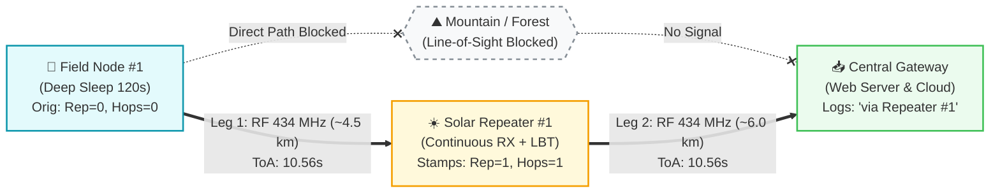
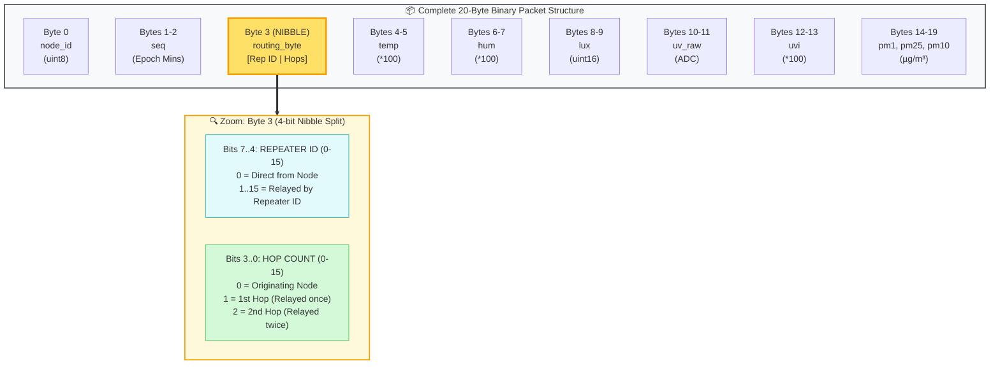
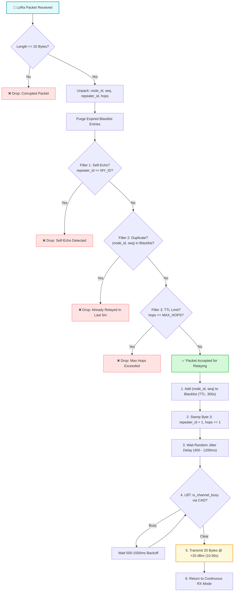
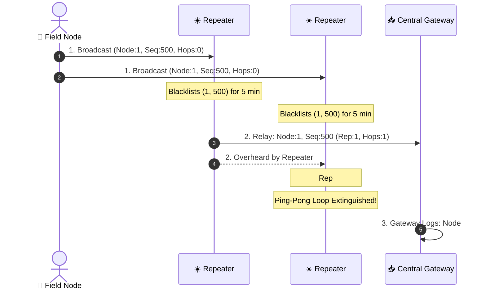
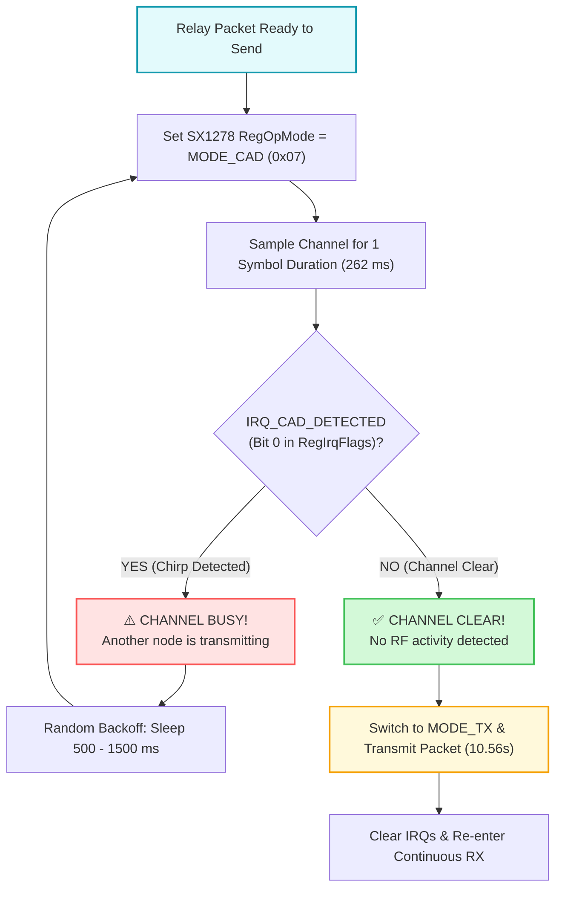

# Visual Guide: LoRa Repeater Architecture & Operation

**Interactive Drawing File:** [`docs/repeater_architecture.excalidraw`](file:///home/iimarky123/Storage/IOT_projects/LORA/docs/repeater_architecture.excalidraw) *(Open directly in VS Code Excalidraw extension or [excalidraw.com](https://excalidraw.com))*  
**Operating Parameters:** 434.00 MHz | SF12 | BW 15.6 kHz | CR 4/5 | Power 20 dBm | 20-Byte Binary Packet  

---

## 1. Network Topology & Obstacle Bypass

In our deployment, direct communication between the remote field node and the central gateway is obstructed by terrain (mountain ridge and dense forest). The solar-powered repeater relay acts as a line-of-sight bridge.

### Excalidraw Architecture Sketch

```
+=========================================================================================================+
|                                  PHYSICAL NETWORK ARCHITECTURE SKETCH                                   |
+=========================================================================================================+
|                                                                                                         |
|   +-----------------------+                                                                             |
|   |    FIELD NODE #1      |                                                                             |
|   |  * Deep Sleep (120s)  |                                                                             |
|   |  * DS1307 Epoch Mins  |                                                                             |
|   |  * TX Power: +20 dBm  |                                                                             |
|   +-----------+-----------+                                                                             |
|               |                                                                                         |
|               | ~ 4.5 km (Weak link, LoS Obstructed)                                                    |
|               | Packet: [Node:1 | Seq:N | Rep:0 | Hops:0]                                               |
|               v                                                                                         |
|   +-----------------------+                    =======================                                  |
|   |   MOUNTAIN OBSTACLE   | -----------------X | DIRECT LINK BLOCKED |                                  |
|   |   Dense Forest / Hill |                    =======================                                  |
|   +-----------+-----------+                                                                             |
|               |                                                                                         |
|               v                                                                                         |
|   +---------------------------------------+                                                             |
|   |      SOLAR REPEATER RELAY #1          |                                                             |
|   |  * Location: Elevated Ridge Pole      |                                                             |
|   |  * 2.5W Solar + 18650 3000mAh Battery |                                                             |
|   |  * Mode: Continuous RX + LBT CAD      |                                                             |
|   |  * Memory: 5-Minute Packet Blacklist  |                                                             |
|   +-------------------+-------------------+                                                             |
|                       |                                                                                 |
|                       | Stamps: [Rep:1 | Hops:1]                                                        |
|                       | ~ 6.0 km (Clear Line of Sight)                                                  |
|                       | Airtime: 10.56s @ 15.6 kHz                                                      |
|                       v                                                                                 |
|   +---------------------------------------+                                                             |
|   |        CENTRAL GATEWAY RECEIVER       |                                                             |
|   |  * Continuous SX1278 RX @ 434 MHz     |                                                             |
|   |  * Decodes: "Node #1 via Repeater #1" |                                                             |
|   |  * Local Web Dashboard (HTTP Server)  |                                                             |
|   |  * MicroSD CSV Logger + ThingSpeak    |                                                             |
|   +---------------------------------------+                                                             |
|                                                                                                         |
+=========================================================================================================+
```

### Mermaid Network Signal Flow



---

## 2. The 20-Byte Nibble Routing Protocol

The payload remains **strictly 20 bytes** to avoid increasing airtime. Byte 3 is split into two 4-bit nibbles encoding both the `repeater_id` and the `hop_count`.



* **On Field Node:** Sets `repeater_id = 0`, `hops = 0` $\rightarrow$ `Byte 3 = 0x00`.
* **On Repeater #1:** Reads `hops (0)`, increments `hops + 1 (1)`, sets `rep_id = 1` $\rightarrow$ `Byte 3 = 0x11`.
* **On Central Gateway:** Unpacks `rep_id = (Byte 3 >> 4)` and `hops = (Byte 3 & 0x0F)`.

---

## 3. Repeater Decision Engine (3-Layer Anti-Loop Filter)

When a packet arrives at the repeater, it passes through 3 sequential filters before transmission:



---

## 4. Multi-Repeater Ping-Pong Loop Extinction

If two repeaters hear each other, the dynamic blacklist terminates circular echoes in **< 1 millisecond**:



---

## 5. Listen-Before-Talk (LBT / CAD) Collision Avoidance

Because transmitting at 15.6 kHz occupies the radio for **10.56 seconds**, the repeater verifies that the channel is quiet before firing the power amplifier:



---

## 6. Sequence Persistence: Epoch Minutes Timeline

Instead of a counter in volatile RAM that resets to 0 on reboot, the sequence number is derived from the **DS1307 RTC**:

$$\text{Sequence} = (\text{Unix Time} \ // \ 60) \ \& \ \text{0xFFFF}$$

```mermaid
flowchart LR
    subgraph T1["⏰ 00:00:00 (Normal Run)"]
        direction TB
        Unix1["Unix: 1,730,592,000"]
        Seq1["Seq = (1730592000 // 60) & 0xFFFF\n= 17,280"]
    end

    subgraph T2["⏰ 00:02:00 (+2 Minutes)"]
        direction TB
        Unix2["Unix: 1,730,592,120"]
        Seq2["Seq = 17,282\n(+2 counts)"]
    end

    subgraph T3["💥 00:04:00 (Power Loss / RST)"]
        direction TB
        Off["Battery Unplugged / Hardware RST\nRAM completely wiped!"]
        Coin["DS1307 Coin Cell keeps clock ticking"]
    end

    subgraph T4["⏰ 00:06:00 (Node Reboots)"]
        direction TB
        Unix4["Unix: 1,730,592,360"]
        Seq4["Seq = 17,286\nStrictly advances by +4!\nNEVER RESETS TO 0!"]
    end

    T1 ==> T2 ==> T3 ==> T4

    style T1 fill:#e3fafc,stroke:#1098ad,stroke-width:1px
    style T2 fill:#e3fafc,stroke:#1098ad,stroke-width:1px
    style T3 fill:#ffe3e3,stroke:#fa5252,stroke-width:1px
    style T4 fill:#d3f9d8,stroke:#40c057,stroke-width:2px
```



* **Zero Flash Wear:** No EEPROM/flash writes; hardware lifespan > 50 years.
* **Continuous Monotonicity:** Resetting the node never causes duplicate drops on the repeater blacklist.

---

## 7. 24-Hour Solar Energy Harvest & Battery Budget

```mermaid
flowchart LR
    Solar["☀️ 2.5W Solar Panel\n(Generates +450 mA in sun)"] --> TP4056["⚡ TP4056 Charger\n(CC/CV 4.2V Cutoff)"]
    TP4056 --> Batt["🔋 18650 Li-Ion Cell\n(3,000 mAh Capacity)"]
    
    Batt --> Sys["🖥️ Repeater System\n(Average Draw: 32.5 mA Standby)\n(TX Draw: 120 mA for 10.56s)"]

    subgraph Budget["📊 24-Hour Energy Balance"]
        direction TB
        DailyConsumption["Total Daily Consumption: ~965 mAh"]
        SolarHarvest["Solar Harvest Time Needed: 2.2 Hours"]
        Autonomy["Reserve Autonomy (No Sun): > 3.1 Days"]
    end

    Sys -. Monitored by .- Budget

    style Solar fill:#fff9db,stroke:#f59f00,stroke-width:2px
    style Batt fill:#d3f9d8,stroke:#40c057,stroke-width:2px
    style Sys fill:#e3fafc,stroke:#1098ad,stroke-width:2px
    style Budget fill:#f8f9fa,stroke:#495057,stroke-width:1px
```



---

## 8. Summary of Active Code Files

* **[`firmware/repeater/config.py`](file:///home/iimarky123/Storage/IOT_projects/LORA/firmware/repeater/config.py):** Repeater hardware pins, `REPEATER_ID = 1`, `MAX_HOPS = 3`, `BLACKLIST_TIMEOUT_SEC = 300`, `LBT_ENABLED = True`.
* **[`firmware/repeater/main.py`](file:///home/iimarky123/Storage/IOT_projects/LORA/firmware/repeater/main.py):** Continuous RX loop, 3-layer anti-loop filter, jitter delay, CAD LBT, and byte-3 header stamping.
* **[`firmware/common/protocol.py`](file:///home/iimarky123/Storage/IOT_projects/LORA/firmware/common/protocol.py):** 20-byte binary packet encoder/decoder with nibble routing in Byte 3.
* **[`firmware/common/sx1278.py`](file:///home/iimarky123/Storage/IOT_projects/LORA/firmware/common/sx1278.py):** SX1278 SPI driver with `is_channel_busy()` LoRa CAD engine.
* **[`firmware/node/main.py`](file:///home/iimarky123/Storage/IOT_projects/LORA/firmware/node/main.py):** Field node with Epoch-Minute sequence generation and LBT channel check.
* **[`firmware/gateway/main.py`](file:///home/iimarky123/Storage/IOT_projects/LORA/firmware/gateway/main.py):** Central gateway displaying `[via Repeater #X (Hops: Y)]`.
